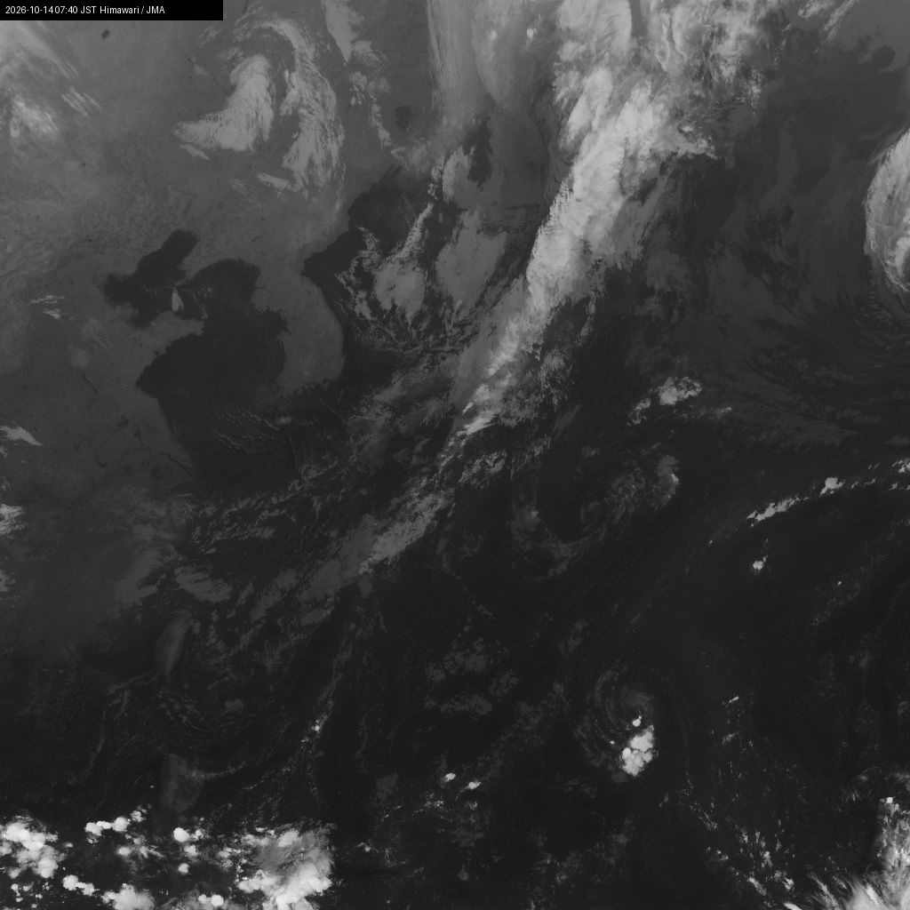

# himawari-gif

気象衛星ひまわりの画像(気象庁ホームページで公開されているタイル画像)から直近のコマを集めて、台風などの雲の動きをアニメーションGIFにする Python スクリプトです。



## 特徴

- 1ファイル・依存は [Pillow](https://pypi.org/project/pillow/) だけ
- 赤外画像(昼夜問わず見える)と自然色画像(昼間のみ)を選べる
- 範囲(緯度経度)・ズーム・コマ数を指定できる
- 各コマに日本時間(JST)のタイムスタンプと出典を描き込む

## 必要なもの

- Python 3.8 以上
- Pillow

```sh
pip install pillow
```

## 使い方

```sh
python himawari_gif.py                 # 赤外画像、直近6時間(36コマ)
python himawari_gif.py --band color    # 自然色(昼間のみきれいに見える)
python himawari_gif.py --frames 72     # 直近12時間
```

ひまわりの画像は10分間隔なので、`--frames 36` で約6時間分になります。

### 範囲を変える

```sh
# 沖縄〜台湾付近を拡大
python himawari_gif.py --lon 118 135 --lat 30 18 --zoom 6 --out okinawa.gif
```

### オプション

| オプション | 既定値 | 説明 |
| --- | --- | --- |
| `--band {ir,color}` | `ir` | `ir`: 赤外(B13)。雲が白いほど雲頂が高い。`color`: 自然色 |
| `--frames N` | `36` | 取得するコマ数(10分間隔) |
| `--zoom Z` | `5` | タイルのズームレベル。大きいほど高精細だが取得枚数が増える |
| `--lon W E` | `120 150` | 西端・東端の経度 |
| `--lat N S` | `45 15` | 北端・南端の緯度 |
| `--out FILE` | `typhoon.gif` | 出力ファイル名 |

## しくみ

1. `targetTimes_fd.json` から利用可能な観測時刻の一覧を取得
2. 指定範囲をズームレベルに応じたタイル座標(Webメルカトル)に変換
3. 各時刻のタイル(256×256 の JPEG)を取得してつなぎ合わせる
4. タイムスタンプを描き込み、150ms/コマのループGIFとして保存

取得できなかったタイルは灰色のまま残ります。

## 注意

- 気象庁サーバーへの負荷に配慮してください。ズームを上げたり範囲を広げたりすると、取得するタイル数は「コマ数 × 横タイル数 × 縦タイル数」で増えます。
- 利用している画像の URL は気象庁ホームページの内部向けのもので、公式に API として提供されているものではありません。予告なく仕様が変わり、動かなくなる可能性があります。
- 長時間・高ズームで作ると GIF のサイズが大きくなります(既定設定でも数十MB になることがあります)。

## 画像が取れない・灰色や砂嵐のようになるとき

このスクリプトは気象庁が公開している画像をそのまま使っているため、衛星や地上設備の側で障害があると、手元のコードを直しても動きません。まず「自分の環境の問題か、配信側の問題か」を切り分けてください。

| 症状 | 考えられる原因 | 確認のしかた |
| --- | --- | --- |
| `時刻リストを取得できませんでした` で終了する | ネットワーク、または `targetTimes_fd.json` の URL・形式の変更 | ブラウザで気象庁の[ひまわり画像ページ](https://www.jma.go.jp/bosai/map.html#contents=himawari)が開くか確認 |
| GIF はできるが全面が灰色 | タイル画像の URL 形式の変更、または配信停止 | 同上。ページで画像が見えているのに灰色なら URL 側の変更を疑う |
| 画像が砂嵐・縞模様・一部欠け | 衛星の観測障害、地上処理システムの障害 | 気象庁の[報道発表](https://www.jma.go.jp/jma/press/)や公式 X([@JMA_kishou](https://x.com/JMA_kishou))に障害情報が出ていないか確認 |

### 過去の配信障害の例

- 2025年10月12日: ひまわり9号の観測に障害が発生し、一時すべての衛星画像の提供が停止。同日中に待機機のひまわり8号へ切り替えて再開し、9号での提供再開は同年11月26日([気象庁報道発表](https://www.jma.go.jp/jma/press/2510/12a/himawari9_shogai_20251012.html))。この間は画像が砂嵐のように乱れた時間帯があった。
- 2022年2月、2020年3月、2018年8月: いずれも地上処理システムの機器障害で、衛星本体は正常のまま一部の画像配信が停止・遅延([2018年の発表](https://www.jma.go.jp/jma/press/1808/28a/himawari20180828.html))。

障害中に取得した時刻帯のコマは、復旧後に取り直しても欠けたままのことがあります。その場合は `--frames` を増やして古い時刻帯を含めるか、復旧後の時刻帯だけで作り直してください。

## 出典

画像: [気象庁ホームページ](https://www.jma.go.jp/bosai/map.html#contents=himawari)(ひまわり画像)

本スクリプトで作成した画像を公開する際は、[気象庁ホームページの利用規約](https://www.jma.go.jp/jma/kishou/info/coment.html)に従い出典を明記してください。
